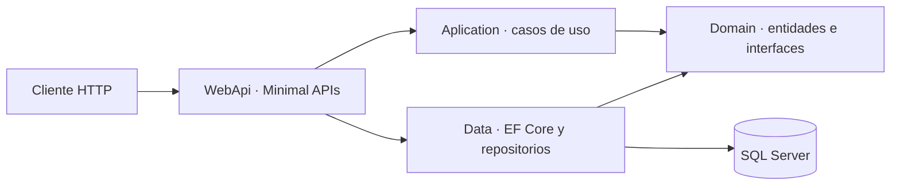
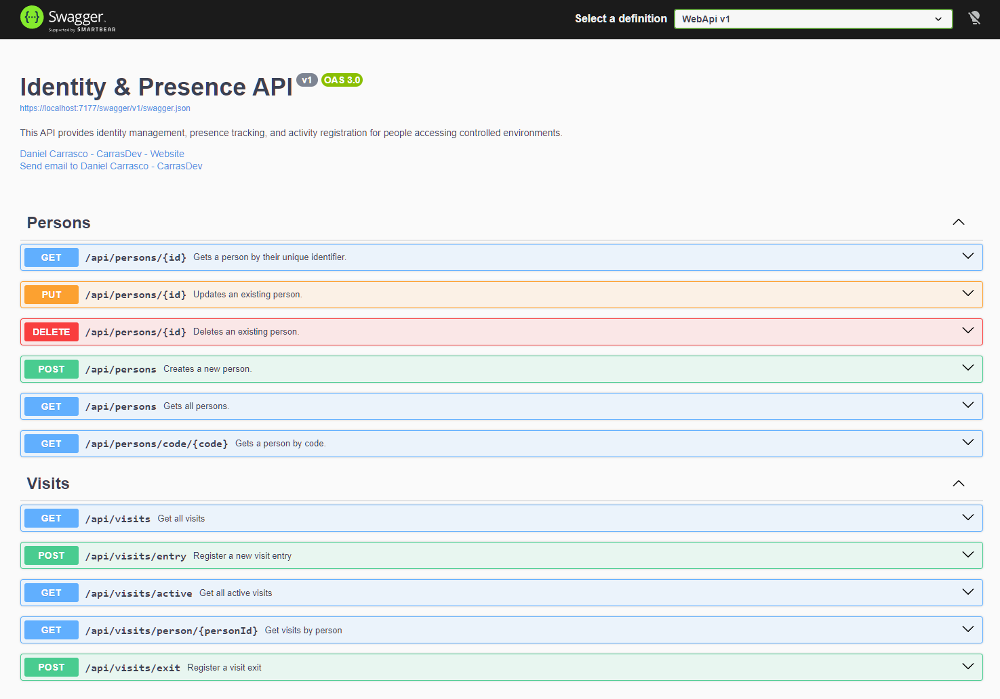

# Identity & Presence API

API REST para gestionar personas y registrar sus entradas y salidas en espacios de acceso controlado. Este proyecto de portfolio muestra una separación por capas en .NET, reglas de dominio y persistencia relacional con Entity Framework Core.

## Funcionalidades

- Crear, consultar, actualizar y eliminar personas.
- Buscar personas por identificador o código único.
- Registrar entradas y salidas de visitas, identificando a la persona por su GUID o código.
- Consultar todas las visitas, las visitas activas y el historial de una persona.
- Aplicar validaciones en el dominio: códigos únicos, datos personales obligatorios y horarios de salida posteriores a la entrada.
- Mantener el esquema de SQL Server mediante migraciones de Entity Framework Core.

Los códigos se guardan en mayúsculas y los correos en minúsculas. Si no se proporciona una hora de entrada o salida, la API utiliza la hora UTC actual. La aplicación impide registrar otra visita activa para una persona que ya tiene una; esta comprobación se realiza en la capa de aplicación.

## Arquitectura

La solución organiza el código en cuatro proyectos:



- **WebApi**: configura la aplicación, la inyección de dependencias y las rutas HTTP.
- **Aplication**: contiene DTOs y casos de uso, coordinando las operaciones mediante interfaces del dominio.
- **Domain**: define las entidades `PersonEntity` y `VisitEntity`, sus reglas y los contratos de repositorio.
- **Data**: implementa esos contratos con Entity Framework Core y SQL Server; incluye el `DbContext` y las migraciones.

## Tecnologías

- .NET 10 y C#.
- ASP.NET Core Minimal APIs.
- Entity Framework Core 10 y SQL Server.
- OpenAPI y Swagger UI para explorar la API durante el desarrollo.

## Requisitos

- .NET SDK 10.
- SQL Server o SQL Server LocalDB.
- `dotnet-ef` 10.0.13 para aplicar las migraciones (si todavía no está instalado):

```bash
dotnet tool install --global dotnet-ef --version 10.0.13
```

## Ejecutar localmente

Desde la raíz del repositorio:

1. Restaura los paquetes:

   ```bash
   dotnet restore PresenceAPI.slnx
   ```

2. Configura la conexión a SQL Server. La configuración incluida en `WebApi/appsettings.json` apunta a `(localdb)\mssqllocaldb` y crea/utiliza la base de datos `RegisterDB`. Para usar otra instancia, establece `ConnectionStrings__DefaultConnection` en el entorno antes de ejecutar los siguientes comandos. No guardes credenciales reales en archivos versionados.

3. Aplica las migraciones:

   ```bash
   dotnet ef database update --project Data/Data.csproj --startup-project WebApi/WebApi.csproj
   ```

4. Confía el certificado HTTPS de desarrollo (solo es necesario configurarlo una vez por equipo):

   ```bash
   dotnet dev-certs https --trust
   ```

5. Inicia la API con el perfil HTTPS:

   ```bash
   dotnet run --project WebApi/WebApi.csproj --launch-profile https
   ```

En desarrollo, este perfil escucha en `https://localhost:7177` y también en `http://localhost:5272`. La aplicación redirige solicitudes HTTP a HTTPS, pero la solicitud inicial por HTTP sigue viajando sin cifrar; utiliza directamente la dirección HTTPS. En el entorno `Development`, Swagger UI está disponible en [`https://localhost:7177/swagger`](https://localhost:7177/swagger) y el documento OpenAPI generado en [`https://localhost:7177/openapi/v1.json`](https://localhost:7177/openapi/v1.json).

Si el certificado local no está disponible o el navegador muestra una advertencia, vuelve a ejecutar `dotnet dev-certs https --trust` y reinicia el navegador.

## Endpoints

Todas las rutas están bajo `/api`.

| Método | Ruta | Descripción | Respuestas principales |
|---|---|---|---|
| `GET` | `/persons` | Lista personas | `200` |
| `GET` | `/persons/{id}` | Obtiene una persona por GUID | `200`, `404` |
| `GET` | `/persons/code/{code}` | Busca por código | `200`, `404` |
| `POST` | `/persons` | Crea una persona | `201`, `400` |
| `PUT` | `/persons/{id}` | Actualiza sus datos personales | `200`, `400`, `404` |
| `DELETE` | `/persons/{id}` | Elimina una persona | `204`, `404` |
| `GET` | `/visits` | Lista visitas | `200` |
| `GET` | `/visits/active` | Lista visitas sin salida registrada | `200` |
| `GET` | `/visits/person/{personId}` | Consulta el historial de una persona | `200` |
| `POST` | `/visits/entry` | Registra una entrada por `personId` o `code` | `201`, `400` |
| `POST` | `/visits/exit` | Registra una salida por `visitId` o `code` | `200`, `400` |

Los identificadores `id`, `personId` y `visitId` son GUID. Las horas opcionales `entryTime` y `exitTime` aceptan fechas ISO 8601; se recomienda incluir la zona horaria, por ejemplo `2026-10-30T12:00:00Z`.

### Ejemplos

Crear una persona:

```bash
curl -X POST https://localhost:7177/api/persons \
  -H "Content-Type: application/json" \
  -d '{
    "code": "VIS-1001",
    "firstName": "Ana",
    "lastName": "García",
    "email": "ana.garcia@example.com",
    "phoneNumber": "612345678"
  }'
```

Registrar una entrada por código (la hora se asigna automáticamente):

```bash
curl -X POST https://localhost:7177/api/visits/entry \
  -H "Content-Type: application/json" \
  -d '{ "code": "VIS-1001" }'
```

Registrar la salida de la visita activa de esa persona:

```bash
curl -X POST https://localhost:7177/api/visits/exit \
  -H "Content-Type: application/json" \
  -d '{ "code": "VIS-1001" }'
```

También se pueden enviar `personId` para la entrada y `visitId` para la salida. Si se proporciona una hora explícita, debe ser posterior a la hora de entrada para poder registrar la salida.

## Documentación de la API

- [Especificación OpenAPI incluida en el repositorio](Docs/openapi.json).
- Swagger UI se habilita en ejecución únicamente en el entorno `Development`.
- Captura de los endpoints:

  

## Estructura del repositorio

```text
Aplication/   DTOs y casos de uso
Data/         DbContext, repositorios y migraciones
Domain/       Entidades y abstracciones
WebApi/       Configuración y endpoints HTTP
Docs/         Especificación OpenAPI y recursos visuales
```

## Alcance actual

La API no configura autenticación ni autorización; no debe exponerse con datos reales o en un entorno público sin añadir esos controles. El repositorio tampoco contiene actualmente un proyecto de pruebas automatizadas.

La configuración local ofrece HTTP y HTTPS para facilitar el desarrollo; usa HTTPS para todas las llamadas, porque una redirección no cifra la solicitud HTTP original. En producción, expón la API solo mediante HTTPS, directamente o terminando TLS en un proxy inverso o balanceador correctamente configurado. Si mantienes HTTP en el borde para redirigir, no lo consideres un canal seguro ni permitas que reciba datos sensibles.

## Licencia

Distribuido bajo **Creative Commons Atribución-NoComercial 4.0 Internacional (CC BY-NC 4.0)**. Se permite compartir y adaptar el código con atribución para fines no comerciales; el uso comercial requiere autorización expresa. Consulta [LICENSE.md](LICENSE.md).
